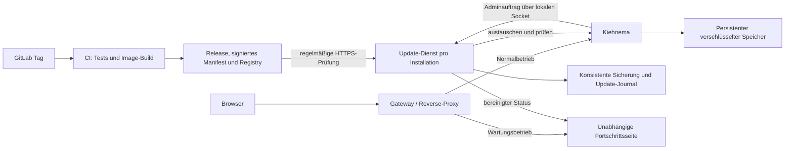

# Kiehnema: Updates aus GitLab über die Oberfläche

Stand: 19.10.2026. ECC Blueprint; Linux-Umsetzung vorhanden. Betriebsanleitung und Abnahmegrenzen: [docs/updates.md](../docs/updates.md).

## Ziel und Empfehlung

Eine freigegebene Version in GitLab wird von jeder erreichbaren, entsprechend eingerichteten Installation regelmäßig erkannt. Ein Administrator sieht die neue Version samt Änderungen und startet das Update mit einem Klick. Download, Prüfung, Datensicherung, Austausch, Startprüfung und gegebenenfalls Rückkehr zur bisherigen Version erledigt die Installation. Während der Unterbrechung bleibt eine Fortschrittsseite unter derselben Adresse erreichbar.

Empfehlung für die erste unterstützte Betriebsform: **Linux-Server mit Docker Compose, dauerhaftem Datenspeicher und einem separaten Update-Dienst.** Dieser wird beim Einrichten mitinstalliert. Automatisch prüfen, Installation bewusst über die Oberfläche starten. Ein Release allein startet kein ungefragtes Update auf allen Kundenservern.

Linux-only wurde vom Nutzer bestätigt. Vorgesehen sind Linux/Docker auf amd64 und arm64; die CI-Matrix verlangt native Runner für beide. Die lokale Integration läuft auf Linux/arm64 in Docker Desktop mit synthetischen Daten. Die Abnahme der tatsächlichen Linux-Hosts und GitLab-Runner steht noch aus. Unterstützung gilt für die veröffentlichte Plattformmatrix, nicht für beliebige Server.

**Einmalige Voraussetzung:** Bestehende Python-/uv-Installationen ohne Update-Dienst müssen einmal in diesen Betriebsstandard übernommen werden. Eine neue GitLab-Version kann alten Installationen keine bisher fehlenden Update-Rechte oder Dienste nachträglich geben. Bei selbst verwalteten Servern erledigt das einmalig der Betreiber; bei zentral verwalteten Servern kann es zentral ausgerollt werden. Danach benötigen unterstützte Anwendungsupdates weder SSH noch Terminal. Betriebssystem, Docker und Hardware bleiben außerhalb dieses Anwendungsupdaters.

## Befund im Repository

| Vorhanden | Konsequenz für den Plan |
| --- | --- |
| Git-Remote `git@git.timeglass.de:mkiehn/kiehnema.git`, Standardbranch `main` | GitLab als Releasequelle passt. Registry-Adresse, Runner und Serverversion sind noch nicht geprüft. |
| `pyproject.toml`: Produktversion `0.1.0`; `package.json`: Demoversion `1.0.0` | Eine verbindliche Produktversion aus `pyproject.toml`; Git-Tag, Image-Metadaten und Anzeige müssen dazu passen. Die npm-Demo ist keine zweite Updatequelle. |
| Keine versionierten Docker-/Compose-Dateien, kein Installer, keine `.gitlab-ci.yml` gefunden | Verpackung und Betriebsstandard sind Teil der Umsetzung. |
| `app/web/main.py`: FastAPI, Hintergrundtasks, Warteschlange; `/healthz` liefert lediglich `status=ok` | Jobaufnahme anhalten, bestehende Arbeit beenden lassen und echte Startbereitschaft gesondert prüfen. |
| `app/web/auth.py`: Adminrolle, Origin-Prüfung, CSRF und RAM-Sitzungen | Updateaktionen sind Adminaktionen mit denselben Schutzmechanismen. Neustart erfordert erneute Anmeldung. |
| `app/security/accounts.py`: SQLite, `service_lock()`, genau ein Prozess pro Datenverzeichnis | Kein paralleler Start alter und neuer App gegen denselben Speicher. |
| `data/secure/`: Kontodatenbank und verschlüsselte Objekte; Nutzerschlüssel nur im RAM | Konsistente Sicherung des gesamten Speichers im Stillstand; keine Schlüssel für Updates persistieren. |
| `app/security/workspace.py`: tmpfs/RAM, restriktive Rechte, unter Linux kein Swap | Container und Installer müssen diese Regeln erfüllen; Prüfungen bleiben aktiv. |
| `app/pipeline/jobs.py`: isolierte Worker und maximal zweistündige Jobs | Einen laufenden Job nicht durch ein Update abbrechen; Warteschlange kann mehrere Jobs enthalten. |
| Jinja, HTMX, lokale JS/CSS-Dateien und vorhandene Browsertests | Vorhandene Oberflächentechnik wiederverwenden. Keine neue Frontendplattform. |

`docs/security.md` und der aktuelle Code sind für den Betrieb maßgeblich; die ältere Tabelle in `docs/PLAN.md` beschreibt noch einen lokalen Einzelbenutzerbetrieb.

## Ablauf für Herausgeber und Nutzer

1. Du erhöhst die Produktversion im freizugebenden Commit und erstellst in GitLab einen geschützten Tag, beispielsweise `v0.2.0`. Das geht auch in der GitLab-Oberfläche.
2. Eine Tag-Pipeline prüft Version und Tests, baut das vollständige Image und veröffentlicht ein signiertes Update-Manifest. Erst nach Erfolg wird das Release als installierbar veröffentlicht. Eine Änderung der Versionsnummer allein genügt nicht. GitLab unterstützt Releases als letzten Pipeline-Schritt. [GitLab Releases](https://docs.gitlab.com/user/project/releases/)
3. Jede Installation prüft beim Start und anschließend etwa alle sechs Stunden mit zufälliger Zeitverschiebung. Zusätzlich gibt es **Check for updates**. Ausgehendes HTTPS genügt; GitLab braucht keinen Zugriff auf die einzelnen Server.
4. Unter **Updates** sieht der Administrator aktuelle Version, Zielversion, Änderungsbeschreibung, letzte erfolgreiche Prüfung und Voraussetzungen. **Install update** startet einen dauerhaften Auftrag.
5. Die Anwendung lädt zunächst die Version herunter und prüft sie. Danach pausiert sie neue Änderungen und wartet auf bestehende Arbeit. Die Oberfläche erklärt diese Wartephase ausdrücklich.
6. Während Sicherung, Austausch und Startprüfung zeigt dieselbe Adresse den Fortschritt. Tab schließen oder Seite neu laden unterbricht den Auftrag nicht.
7. Bei Erfolg erscheint **Update complete — sign in again**. Bei einem Startfehler wird vor Wiederfreigabe der bisherigen Betriebsversion ihr passender Datenstand wiederhergestellt. Die Oberfläche meldet das Ergebnis verständlich.

Die Oberfläche bleibt wie die bestehende Anwendung englisch. Beispiel:

```text
Update available: 0.1.0 → 0.2.0
Last checked: today, 14:10
[Release notes]                         [Install update]

Updating Kiehnema
[████████████░░░░░░░░]  Download: 128 / 240 MB
✓ Compatibility checked
● Downloading update
○ Waiting for current work to finish
○ Backing up data
○ Installing and checking the new version
```

Prozentwerte nur für messbare Arbeit wie übertragene Bytes. Für Jobwartezeit und Neustart eine unbestimmte Fortschrittsanzeige mit aktuellem Schritt; keine erfundenen Prozent oder garantierten Minutenangaben. Anzeige mit beschriftetem `<progress>`, Tastaturbedienung, `aria-live="polite"` und Unterstützung reduzierter Bewegung.

## Architektur und Grenzen



- **App:** Vollständiges, unveränderliches Image mit Python, gesperrten Python-/npm-Abhängigkeiten, Chromium, FFmpeg und lokalen Assets. Kein Installieren von Abhängigkeiten auf dem Kundensystem während des Updates. Nicht als root betreiben und Chromium-Sandbox beibehalten.
- **Datenspeicher:** Fester externer Mount für `MG_DATA_DIR`, eigener tmpfs-Mount für `MG_WORK_DIR`, gleicher Betriebsnutzer/UID über Versionen. Geheimnisse werden zur Laufzeit eingebunden und niemals ins Image kopiert. Build-Kontext mit `.dockerignore` gegen `.env`, Daten, `.git`, AWS-Zugangsdaten und lokale Ausgaben abgrenzen.
- **Update-Dienst:** Separater Prozess/Container, unabhängig vom App-Neustart. Verwaltet Prüfung, Downloads, einen Auftrag gleichzeitig, Sicherung und Wiederherstellung. Ein persistentes Journal und ein Prozess-Lock überleben Neustarts. Kein Scheduler nur im Browser oder in einer HTTP-Anfrage.
- **Rechte:** Nur der Update-Dienst erhält den nötigen Containerzugriff; die Web-App erhält keinen Docker-Socket. Der Dienst akzeptiert über einen geschützten lokalen Socket ausschließlich feste Aktionen und eine zuvor geprüfte Release-ID, keine Shellbefehle, frei wählbaren Images, Pfade oder Compose-Dateien. Socket-Rechte und Protokollauthentisierung sind zu prüfen. Dockerzugriff ist weitreichend und muss als privilegierter Teil der Installation behandelt werden. [Docker Engine security](https://docs.docker.com/engine/security/)
- **Gateway:** Bleibt während App-Updates bestehen. Liefert eigene Wartungsassets und einen bereinigten, atomar geschriebenen Status aus. Direkter öffentlicher Zugriff auf App-Port, interne Steuerung, Update-Journal oder Backups ist ausgeschlossen. HTTPS, Header-Vertrauen und deaktivierte URL-/Body-Logs aus `docs/security.md` bleiben erhalten.
- **Statuszugriff:** Öffentliche Wartungsantworten enthalten ausschließlich allgemeine Phase, Fortschritt und Erreichbarkeit. Keine Konten, Jobnamen, IDs, Rohlogs, Tokens oder Serverpfade. Detailfehler nur im angemeldeten Adminbereich. Während die App fehlt, gibt es keine öffentlich nutzbare Installations- oder Restore-Aktion.
- **Polling:** Der Browser fragt während des Updates etwa alle zwei Sekunden den unabhängigen Status ab. Verbindungsverlust zeigt „Reconnecting“, kein vermeintlich erfolgreiches Update. Ein Zeitstempel/Heartbeat unterscheidet laufende Arbeit von einem ausgefallenen Updater; veralteter Status führt zu einer verständlichen Störungsanzeige statt endlosem Fortschritt. Nicht verfügbare App-Antworten werden vom Gateway durch die Wartungsseite ersetzt; Status und Wartungsassets bleiben erreichbar. Außerhalb eines laufenden Updates muss ein echter App-Ausfall erkennbar bleiben.

## Release- und Zugriffskontrakt

Die Releases API wird paginiert gelesen. Aus ausschließlich vollständig veröffentlichten, signierten Stable-Releases wird die höchste passende numerische `MAJOR.MINOR.PATCH`-Version ausgewählt. Tags mit Prerelease-Suffix, zukünftige Veröffentlichungen, fehlende Artefakte und inkompatible Versionen werden nicht angeboten. GitLabs `latest` sortiert nach Veröffentlichungsdatum, nicht zuverlässig nach semantischer Version. [Releases API](https://docs.gitlab.com/api/releases/)

Ein kleines, versioniertes JSON-Manifest enthält mindestens Produktversion, Commit, unterstützte Plattformen, Manifestformat, minimal unterstützte App-/Updater-Version sowie Datenformat vor/nach dem Update. Sämtliche austauschbaren Komponenten sind über feste Rollen und unveränderliche Digests gebunden: App, Updater, Austauschhelfer, Gateway und Installations-/Compose-Artefakte, soweit im betreffenden Release benötigt. Dazu kommen Veröffentlichungszeitpunkt und signierte Änderungsbeschreibung. Die Kompatibilitätsangaben decken auch die gemeinsam wiederherstellbare Kombination ab. Keine ausführbaren Installationsbefehle oder frei definierbaren Rollen im Manifest. SHA-Digests sichern die konkreten Artefakte; eine Ed25519-Signatur über die exakten Manifestbytes mit installiertem Vertrauensschlüssel belegt ihre Herkunft. Die vorhandene `cryptography`-Abhängigkeit reicht dafür.

Release, Signatur und Image müssen zusammenpassen. Verifikation vor jeder Ausführung; keine Installation eines bloßen `latest`-Tags. HTTPS-Ziele und Redirects werden auf konfigurierte GitLab-/Registry-Hosts beschränkt; Zugangsdaten niemals an fremde Redirect-Ziele weitergeben. Size-Limits, Timeouts und begrenzte Wiederholungen gelten auch für Metadaten.

Veröffentlichung aus geschützten Tags mit geschützten CI-Schlüsseln. Keine veränderlichen Images unter derselben Version und keine kurzlebigen CI-Artefakte als einzige Downloadquelle; Manifest/Signatur gehören in dauerhafte Release-/Package-Ablage. [GitLab Release assets](https://docs.gitlab.com/user/project/releases/release_fields/)

Für ein privates GitLab-Projekt: serverseitiger Projektzugang mit den minimal nötigen Leserechten für Release-API und Registry, voraussichtlich `read_api` und `read_registry`, bei der Umsetzung mit der tatsächlichen GitLab-Version prüfen. Kein persönlicher Maintainer-Token auf Kundensystemen. Zugang in der Oberfläche prüfen/ersetzen können; Ablauf und 401/403 anzeigen, ohne den normalen Betrieb zu blockieren. Unterschiedliche Installationen sollen getrennt widerrufbare Zugänge erhalten. Ein bloßer Deploy-Token kann zwar die Registry lesen, aber nicht allgemein die Releases API. [Project access tokens](https://docs.gitlab.com/user/project/settings/project_access_tokens/), [Registry authentication](https://docs.gitlab.com/user/packages/container_registry/authenticate_with_container_registry/), [Deploy tokens](https://docs.gitlab.com/user/project/deploy_tokens/)

Vor Ausgabe von Zugängen deren tatsächlichen Leseumfang prüfen. Falls Installationen keinen Zugriff auf Quellcode oder interne Projektmetadaten erhalten dürfen, Release-Artefakte in einem separaten Auslieferungsprojekt bereitstellen. Dafür wird nicht automatisch das bestehende Repository öffentlich gemacht. Keine Zugangsdaten an Browser-JavaScript, Logs oder Pipeline-Worker vererben.

Alte Installationen müssen angebotene Zwischenschritte selbst finden können: Kann die neueste Version nicht direkt installiert werden, zeigt die UI den benötigten Updatepfad an und führt die kompatiblen Schritte im selben Auftrag aus. Dafür bleiben benötigte Zwischenreleases und ihre Artefakte verfügbar; der älteste unterstützte Ausgangsstand wird veröffentlicht und getestet. Ein ausgelassenes Release darf keinen manuellen Servereingriff erzwingen. Netzwerkprobleme führen zu Backoff und einer Anzeige der letzten erfolgreichen Prüfung; die App arbeitet weiter.

Bei mehreren Schritten den vollständigen Pfad vorab prüfen und alle benötigten Artefakte herunterladen. Danach bleibt die Installation bis zum letzten Ziel in Wartung, ohne Benutzerwrites zwischen den Schritten. Vor jedem Schritt entsteht ein konsistenter Wiederherstellungspunkt aus App, Daten, Konfiguration und gegebenenfalls Updater. Scheitert ein späterer Schritt, wird der letzte vollständig verifizierte Zwischenstand wiederhergestellt; der Gesamtauftrag meldet einen Fehler und nennt den tatsächlich aktiven Stand. Ein Zwischenstand ist ein interner Wiederherstellungspunkt, kein vorzeitiger Gesamterfolg.

## Sichere Update-Transaktion

| Phase | Verhalten und Fehlerfall |
| --- | --- |
| `checking` | Rechte, Signatur, Plattform, Speicherplatz für Image, Sicherung und Migration, Versionen und Upgradepfad prüfen. Bei Fehler keine Betriebsänderung. |
| `downloading` | Artefakte vollständig laden und gegen geprüften Digest verifizieren. Alte App arbeitet weiter. Bei Abbruch kann später erneut versucht werden. |
| `draining` | Jobaufnahme und neue schreibende UI-Aktionen atomar sperren; bereits gestartete Requests/Tasks und alle wartenden Jobs bis zum sicheren Ende auslaufen lassen. Auch direkte CLI-Starts/Resume unterliegen der Sperre. Read-only-Zugriffe bleiben zunächst möglich. |
| `waiting` | Bestehende Queue kann länger als zwei Stunden brauchen. Begrenzte Wartefrist: bei Überschreitung Update vor dem Stop abbrechen, Sperre lösen und späteren Versuch anbieten; keine Jobs zwangsweise beenden. Vor dem Stop darf der Admin den Updateversuch abbrechen. |
| `backing_up` | Gateway in Wartung, App geordnet stoppen, alle Worker beenden lassen, exklusiven Datenlock übernehmen. Vollständiges `data/secure/` mit Kontodatenbank und Objektdateien sichern. Zusätzlich bisheriger Image-Digest, Schema-/Konfigurationsstand und nötige Berechtigungen. Backup vollständig schreiben, verifizieren und erst dann als verwendbar markieren. RAM und entschlüsselte Arbeitsdaten ausschließen. |
| `migrating` | Unter exklusivem Lock erforderliche Schema-/Dateiformatänderungen ausführen und protokollieren. Kein zweiter App-Prozess. Fehlende Nutzerschlüssel nicht umgehen: verschlüsselte Inhalte entweder formatkompatibel halten oder nach regulärer Anmeldung migrieren. |
| `starting` | Genau das geprüfte Image starten. Stärkere interne Readiness prüft Version, Datenbankschema, Datenzugriff, RAM-Regeln und lokale Laufzeitabhängigkeiten. Kein billabler Bedrock-Aufruf und keine Entschlüsselung fremder Inhalte als Healthcheck. Gateway bleibt in Wartung. |
| `succeeded` | Erst nach erfolgreicher Readiness neue Version als aktiv markieren, Wartung aufheben und Anmeldung anbieten. Alte Version und passende Sicherung für die dokumentierte Rückkehrfrist behalten. |
| `rolling_back` | Neue App wieder stoppen; aus vollständig validierter Sicherung Daten/Config und bisherigen Image-Digest zusammen wiederherstellen. Auch Restore ist journalisiert, wiederholbar und gegen Stromausfall abgesichert. Alte Version auf Bereitschaft prüfen, danach erst Wartung aufheben. |
| `failed` | Falls selbst die Wiederherstellung scheitert, Wartungsseite mit Fehlerreferenz behalten, Original und Sicherung unangetastet erhalten. Kein unendlicher Ladebalken und kein weiteres automatisches Überschreiben. Dieser Ausnahmefall benötigt Betreiberhilfe. |

Jeder Übergang wird vor/nach dem relevanten Schritt dauerhaft und atomar protokolliert. Nach Prozess- oder Host-Neustart wird der tatsächliche Container-/Datenzustand mit dem Journal abgeglichen; ein halb vollzogener Schritt wird sicher abgeschlossen oder zurückgenommen. Erfolg wird nie allein aus einem alten Fortschrittswert abgeleitet. Der App-Neustart darf die Wartungssperre nicht stillschweigend löschen.

Der verwaltete App-Einstieg prüft die dauerhafte Startfreigabe bereits **vor** Admin-Setup, Datenbankinitialisierung und FastAPI-Lifespan. Bei einer offenen Transaktion entscheidet zuerst der Updater, welches Image mit welchem Datenstand starten darf. Eine Docker-Restart-Policy darf diesen Ablauf nicht umgehen. Nach Host-Neustart startet das Gateway geschlossen in Wartung, bis der bekannte konsistente Zustand geprüft ist; eine alte Erfolgsdatei genügt nicht. Autoritative Freigabe-/Journaldateien sind nur für den Updater schreibbar.

Admission-Gate vor der ersten Datenmutation platzieren, nicht erst in `enqueue()`: `create_job()` legt bereits vorher Daten an; `reopen()` und weitere Schreibpfade umgehen diese Funktion. Bei Eintritt in die Drain-Phase laufende Mutationen mitzählen und abschließen lassen.

Die bestehende Exklusivität von `service_lock()` erhalten, aber ihre Umsetzung vor Wiederverwendung korrigieren: Heute initialisiert sie die Datenbank vor dem Lock und speichert die Lockdatei innerhalb von `secure/`. Der neue feste Lockpfad liegt außerhalb des austauschbaren Restore-Baums, beispielsweise direkt unter `MG_DATA_DIR`, und wird niemals durch Sicherung/Restore ersetzt. App-, CLI-, Setup-, Migrations- und Restore-Einstiege übernehmen denselben Lock vor ihrem ersten Datenbankzugriff. Worker bleiben unter der Eigentümerschaft ihres koordinierenden Prozesses; sie versuchen nicht, dessen exklusiven Lock nochmals zu übernehmen. Vor Restore muss der gesamte bisherige Prozessbaum beendet sein. Beim App-Start Lock-Übergabe und dauerhafte Startfreigabe gemeinsam koordinieren.

Ein Zurücksetzen nur des Containerimages ist bei veränderter Datenbank unzureichend. Automatisches Zurücksetzen ist hier auf die Wartungsphase begrenzt, bevor Benutzer mit der neuen Version schreiben dürfen. Ein späteres Rollback könnte neue Arbeit löschen und gehört nicht zum automatischen Fehlerpfad. Lokale Update-Sicherungen sind kein Ersatz für externe Backups bei Plattenverlust. Nach erfolgreichem Update wird eine begrenzte Aufbewahrung alter Sicherungen eingerichtet; die letzte verifizierte Rückkehrmöglichkeit darf nicht vorzeitig entfernt werden.

## Auch der Updater muss aktualisierbar bleiben

Ein dauerhaft eingefrorener Updater würde das Versprechen später brechen. Das erste Format enthält deshalb eine Updater-Protokollversion und einen kompatiblen Pfad zur nächsten Updater-Version. Manifestformate bleiben für den ältesten unterstützten Updater lesbar; Formatwechsel erfolgen über ein verständliches Zwischenrelease. Vertrauensschlüsselwechsel benötigen eine vom bisherigen Schlüssel autorisierte Übergabe mit Überlappung.

Bei Containerbetrieb ersetzt sich der laufende Updater nicht mitten in seiner Transaktion selbst. Er lädt und verifiziert die neue Version vorab und übergibt einen minimalen, fest definierten Austauschauftrag an einen kurzlebigen lokalen Helfer aus einem bereits vertrauten Image. Dieser ersetzt ausschließlich den fest benannten Updater, prüft dessen Bereitschaft und kann auf den alten Digest zurückwechseln. Journal, Sperre und Statusverzeichnis bleiben außerhalb beider Container; kein gleichzeitiger Transaktionseigner. Gateway und App bleiben für ein reines Updater-Update bestehen. Diese Wiederaufnahme einschließlich Host-Neustart wird getestet.

Gateway-/Compose-Änderungen gehören ebenfalls zum versionierten Installationsformat. Sie dürfen nur aus geprüften Veröffentlichungen übernommen werden; lokale Secrets, Domains und Datenmounts bleiben erhalten. Ein Gateway-Neustart kann eine kurze Browser-Neuverbindung erfordern. Docker-/OS-Upgrades oder ein neuer Hardwarebedarf können nicht als normales Anwendungsupdate garantiert werden; solche Releases zeigen vorher eine verständliche Voraussetzung an.

## Umsetzung in sieben reviewbaren Merge Requests

Alle Schritte starten vom aktuellen `main` in einem eigenen Branch und enden mit einem GitLab-MR samt Prüfung und gegebenenfalls UI-Screenshot. Die folgenden Dateien/Testnamen sind geplante Ziele, keine Behauptung bereits existierender Implementierung. Keine Live-Bedrock-Tests aktivieren.

### 1. Versions-, Manifest- und Kompatibilitätsvertrag

**Kontext:** Die App kennt noch keinen Updatevertrag; Python-Produktversion und npm-Demoversion unterscheiden sich. Verschlüsselte Nutzerdaten sind ohne Anmeldung nicht allgemein migrierbar.

- Produktversion, Stable-Tagformat, Signaturbytes, feste Komponentenrollen/-Digests, Daten-/Updater-Versionen und unterstützte Upgradepfade festlegen. Eine kleine Releasefixture für gültig, manipuliert und inkompatibel anlegen.
- Berührt: `pyproject.toml`, bei nötiger Lock-Aktualisierung `uv.lock`, neu `docs/updates.md`, `app/updates/manifest.py`, `tests/test_updates.py`, `tests/fixtures/updates/`. Keine globale Versionsumschreibung der Demo nötig.
- **Prüfung:** `uv run pytest tests/test_updates.py -q`; Version `0.10.0` größer als `0.9.0`, Prereleases ausgeschlossen, Signatur-/Digestfehler abgewiesen, alte unterstützte Manifeste lesbar.
- **Fertig:** Ein validiertes Manifest beschreibt ein konkretes, kompatibles Artefakt ohne beliebige ausführbare Anweisungen.
- **Rücknahme:** Neue unbenutzte Vertragsmodule zurücknehmen; noch keine Produktionsmigration. **Modell:** stärkstes verfügbares für Sicherheits-/Kompatibilitätsentwurf.

### 2. Reproduzierbare Installation mit getrenntem Gateway und Updater

**Kontext:** Bisher wird direkt per `uv run python -m app` gestartet. `MG_DATA_DIR` und `MG_WORK_DIR` ermöglichen feste externe Speicherpfade; Setup ohne Terminal ist bereits vorgesehen.

- Dockerfile, `.dockerignore`, Compose-Konfiguration und Installer für die vereinbarte Linux-Plattform bauen. Vollständige Laufzeitabhängigkeiten aus Lockfiles; eigener Nutzer, funktionierende Chromium-Sandbox, tmpfs und bestehende Swap-Prüfung.
- Gateway mit unabhängigen Wartungsassets/Status, lokalen Sockets und dauerhaftem Updateverzeichnis aufsetzen. Secrets außerhalb der Images; keine neue öffentliche Registrierung.
- Übernahme bestehender verschlüsselter Installation im Stillstand vorsehen: Original sichern, Daten vollständig kopieren, Rechte prüfen, reguläre Anmeldung und vorhandenes Video prüfen; Original erst nach erfolgreicher Abnahme separat stilllegen.
- Berührt: neu `deploy/`, `Dockerfile`, `.dockerignore`, `compose.yaml`, Updater-Einstiegspunkt; bestehend `.env.example`, `README.md`, `docs/security.md`, ggf. Startkonfiguration in `app/__main__.py`. Erst bei Änderungen an Settings deren Aufrufer nachziehen.
- **Prüfung:** `docker compose config --quiet`, Image-Build und Start in einer isolierten Linux-VM; Testvideo aus lokaler Fixture ohne Bedrock rendern; App-Neustart erhält verschlüsselte Jobs; RAM-/Sandbox-Regeln bleiben aktiv.
- **Fertig:** Ein neuer Server und eine migrierte Testinstallation benutzen denselben reproduzierbaren Betriebsstandard; Gateway überlebt App-Stop.
- **Rücknahme:** Alte Installation mit unverändertem Originalspeicher weiterbetreiben. **Modell:** Standard; Sicherheitsreview der Laufzeitrechte.

### 3. GitLab-Veröffentlichung und regelmäßige Prüfung

**Kontext:** Das echte Remote liegt auf `git.timeglass.de`; Registry, Runner und Berechtigungen müssen vor Ort verifiziert werden. Schritt 1 liefert Manifestvertrag, Schritt 2 das baubare Image.

- Geschützte Tag-Pipeline: Test → Build → Registry/Manifest/Signatur → Release. Bei Fehler kein installierbares Release. Abhängigkeiten und Buildwerkzeuge pinnen; reale Registry-Adresse ermitteln.
- Polling im separaten Updater mit sechs Stunden plus Jitter, Startprüfung, manueller Prüfung, Pagination, numerischem Versionsvergleich und Backoff. Read-only-Zugänge und Tokenablauf unterstützen.
- Berührt: neu `.gitlab-ci.yml`, `app/updates/releases.py`, Veröffentlichungsskript unter `scripts/`, Updater-Scheduler, `tests/test_updates.py`. Zugangskonfiguration ausschließlich beim Update-Dienst.
- **Prüfung:** GitLab CI Lint und Test-Tag im Testprojekt; `uv run pytest tests/test_updates.py -q`; 401/403, Timeout, Rate-Limit, falsche Signatur, nachträglich veröffentlichte ältere Version und fehlendes Image simulieren.
- **Fertig:** Zwei Testinstallationen erkennen unabhängig dasselbe erfolgreiche Release; fehlgeschlagene Veröffentlichungen und betriebsfremde Releases werden nicht angeboten.
- **Rücknahme:** Polling deaktivieren bzw. Release aus der angebotenen Menge zurückziehen; laufende App unverändert. **Modell:** Standard.

### 4. Update-Transaktion, Jobruhe, Migration und Wiederherstellung

**Kontext:** Tasks und Sitzungsschlüssel liegen im App-RAM; ein Neustart unterbricht Jobs. SQLite und verschlüsselte Objekte bilden gemeinsam den Sicherungsstand. Der bisherige Healthcheck ist nur Liveness.

- Obige Zustandsmaschine, dauerhaftes Journal, Operationslock und idempotenten Installationsauftrag umsetzen. Den bestehenden Datenlock vor jeden initialen Datenzugriff und an einen festen Pfad außerhalb des Restore-Baums verschieben. Alle Job-/Schreibpfade und CLI-Einstiege vor Mutation durch das Admission-Gate führen.
- Quieszenz, App-Stop, konsistente Sicherung, explizite Migration, Digestwechsel, interne Readiness und automatisches Restore vor Wiederfreigabe implementieren. Job-Review und Renderfreigabe bleiben unverändert erforderlich.
- Berührt: neu `app/updates/transaction.py` und gezielte Tests; bestehend `app/__main__.py`, `app/web/main.py`, `app/web/auth.py`, `app/pipeline/jobs.py`, `app/pipeline/__main__.py`, `app/security/__main__.py`, `app/security/accounts.py`; Datenformatadapter nur dort ergänzen, wo echte Formatänderungen nötig sind.
- **Prüfung:** `uv run pytest tests/test_updates.py tests/test_security.py tests/test_pipeline.py tests/test_web.py -m 'not browser' -q`; Restore mit synthetischen verschlüsselten Mehrbenutzerdaten; Doppelklick, konkurrierender Jobstart, App-/CLI-Start während Restore ohne vorherige DB-Mutation, volle Platte, Migrationsfehler, falscher Readiness-Digest, Prozessabbruch an jedem destruktiven Übergang.
- **Fertig:** Fehler vor Stop lassen die alte App laufen; Fehler nach Stop führen zur verifizierten alten App mit passendem Datenstand oder zu einem klaren, sicheren Fehlerzustand. Keine heimlichen Jobverluste, kein paralleler Datenzugriff.
- **Rücknahme:** Updatefunktion sperren; für bereits begonnene Transaktionen den vereinbarten Restorepfad verwenden. **Modell:** stärkstes verfügbares; Schwerpunkt Datenverlust und Race Conditions.

### 5. Adminoberfläche und Fortschrittsseite

**Kontext:** Jinja/HTMX, Adminrolle, CSRF, lokale Assets und englische Beschriftung existieren. App-Sitzungen werden durch Neustart ungültig; Wartungsanzeige muss daher ohne deren Fortbestand funktionieren.

- Adminnavigation **Updates**, Versionsvergleich, Releasebeschreibung, Prüfung, Zugangstest/-ersatz und Start/Abbruch vor dem Stop ergänzen. Nur bestehende Administratoren dürfen steuern; Origin/CSRF bei sämtlichen Mutationen. Releasebeschreibungen als escaped Text oder sicher gerendertes Markdown, niemals ungeprüftes HTML aus GitLab einbetten.
- Start-POST liefert sofort eine Auftragsbestätigung; wiederholter POST erzeugt keinen zweiten Auftrag. Polling und Neuverbinden verwenden den dauerhaften Status. Öffentliche Wartungsantworten bleiben minimal.
- Berührt: neu `app/web/updates.py`, `app/web/templates/updates.html`, gezielte JS-Datei und Gateway-Wartungsassets; bestehend `app/web/main.py` für Router, `base.html`, `app.css`, `tests/test_web.py`. Kein eigener Frontend-Stack.
- **Prüfung:** `uv run pytest tests/test_web.py -q`; Browserfälle mit laufender Fake-Transaktion, gestoppter App, Tab-Neuladen, Netzunterbrechung, doppeltem Klick, Erfolg und Rollback; Admin-/Normalnutzer-/CSRF-Fälle; Tastatur und Screenreaderstatus prüfen. Screenshots in den MR.
- **Fertig:** Gesamter normale Updateweg ist ohne Terminal bedienbar; kein Abbruch durch Reload, keine Endlosschleife nach Fehler und verständliche erneute Anmeldung.
- **Rücknahme:** Oberfläche ausblenden; laufende Aufträge bleiben vom Updater abschließbar. **Modell:** Standard.

### 6. Updater-, Installationsformat- und Schlüsselwechsel

**Kontext:** Der separate Updater braucht selbst Sicherheitsupdates. Ältere Installationen dürfen weder an einer neuen Manifestversion noch an einem Schlüsselwechsel hängen bleiben.

- Vorab geprüften Updaterwechsel mit kurzlebigem Helfer, eigener Bereitschaftsprüfung, Journalübergabe und Rückkehr zum alten Digest realisieren. Alle Helferaktionen fest auf die eigene Installation begrenzen.
- Upgradepfade mit notwendigen Zwischenreleases, kompatible Vertrauensschlüsselübergabe und Änderungen am Installationsformat implementieren. Gateway-/Compose-Updates erhalten lokale Konfiguration.
- Berührt: Updater-/Helferstart und `deploy/`, Manifestvertrag und Fixtures nur kompatibel erweitern, `tests/test_update_recovery.py`, `docs/updates.md`.
- **Prüfung:** `uv run pytest tests/test_update_recovery.py -q` plus isolierte Linux-Integration: ältester unterstützter Updater → Zwischenversion → Ziel; Fehler nach erfolgreichem Zwischenstand stellt dessen vollständige Kombination ohne zwischenzeitliche Benutzerwrites wieder her; Stromausfall beim Austausch; defekter neuer Updater; Schlüsselwechsel; bestehende Domain/Secrets/Mounts erhalten.
- **Fertig:** Auch ein notwendiges Updaterupdate läuft über denselben Adminauftrag, mit funktionsfähigem Fehlerpfad.
- **Rücknahme:** Helfer aktiviert bisherigen Updater und unveränderte Installationskonfiguration. **Modell:** stärkstes verfügbares für Prozessübergabe und Vertrauenskette.

### 7. Upgradeprobe und betriebliche Abnahme

**Kontext:** Einzeltests beweisen keine Wiederherstellung zwischen realen Versionen. Plattform, GitLab-Instanz, Datensicherung und Browser müssen zusammen geprüft werden.

- Reproduzierbare Linux-Tests mit zwei Installationen, zwei echten Release-Images, synthetischen Nutzern/Jobs, Fehlerversion und übersprungenem Release. Pro unterstützter Plattform den ältesten Ausgangsstand und einen aktuellen Stand prüfen.
- Erreichbares Gateway während App-Ausfall, automatisches Wiederanlaufen nach Host-Neustart, konsistente Wiederherstellung, erneute Anmeldung/Entschlüsselung sowie Vorschau und Renderfreigabe überprüfen. Keine Live-Bedrock-Aufrufe.
- Berührt: Integrationstests, `.gitlab-ci.yml`, Release-Checkliste in `docs/updates.md`, `README.md` und `docs/security.md`. CI darf Test-VMs, aber keine Produktivserver bedienen.
- **Prüfung:** `uv run pytest`; `uv run pytest tests/test_web.py -m browser -q`; definierte VM-Upgrade-/Crash-Matrix ausführen. Die Integrationsbefehle werden mit dem tatsächlichen Harness dokumentiert, nicht als bereits existierende Kommandos erfunden.
- **Fertig:** Ein Administrator veröffentlicht einen GitLab-Tag und führt auf beiden Installationen normale, übersprungene und absichtlich fehlschlagende Updates allein über die UI durch. Daten und Recovery funktionieren; Grenzen und Ausnahmehilfe sind dokumentiert.
- **Rücknahme:** Erstes Angebot auf Testinstallationen begrenzen; fehlerhafte Version zurückziehen, Vorgängerversion/Artefakte behalten. **Modell:** Standard mit unabhängigem Review der Ergebnisse.

Abhängigkeiten: `1 → 2 → 3 → 4 → 5 → 6 → 7`. Bewusst zunächst seriell: Rechte, Manifest, Laufzeit und Wiederherstellung teilen Schnittstellen. Nach Schritt 3 kann das UI-Layout mit Fake-Status parallel zu Schritt 4 vorbereitet werden, sofern Änderungen an `main.py` und gemeinsamen Verträgen beim Integrationsschritt bleiben. Kein zusätzlicher Agentenaufwand nur für vermeintliche Parallelität.

## Gesamte Abnahme und verbleibende Entscheidungen

Erfolg bedeutet: Erkennen, sicher installieren, Fortschritt anzeigen, Daten erhalten und bei fehlgeschlagenem Start wiederherstellen — auf allen ausdrücklich unterstützten Installationen einschließlich solcher mit ausgelassenen Versionen. Nicht ausreichend ist ein grüner HTTP-Status nach einem Containerneustart.

Vor Umsetzung klären bzw. prüfen:

1. Existierende Installationsarten und CPU-/Linux-Versionen; gegebenenfalls einmalige Übernahme planen.
2. Registry, Runner, Projekt-ID und Berechtigungen auf `git.timeglass.de`; private Auslieferung und Tokenumfang verifizieren.
3. Speicher-/RAM-Bedarf, Backupaufbewahrung, unterstützte Ausgangsversionen und Aufbewahrung notwendiger Zwischenreleases anhand realer Installationen festlegen.

Bewusst außerhalb der ersten Version: ungefragte automatische Installation, Beta-Kanäle, zentraler Flottenserver, Telemetrie, Kubernetes, Zero-Downtime mit zwei App-Schreibern und allgemeine OS-Upgrades. Die reguläre Prüfung und der vollständig bedienbare Update-/Fehlerpfad gehören dagegen zum Kernumfang.

Bei Planänderungen den betroffenen Schritt und seine Abhängigkeiten gemeinsam aktualisieren; gesplittete Schritte behalten ihre Abnahmekriterien. Änderungen an Rechten, Datenformat, Restore oder Vertrauenskette erneut unabhängig prüfen. Kein Schritt gilt als abgeschlossen, solange sein Fehlerpfad fehlt.

Plan- und Implementierungsprüfung: unabhängiges ECC-Blueprint-Review durchgeführt. Stabiler Datenlock vor Datenbankzugriff, Wiederherstellung mehrstufiger Updates und Signaturbindung aller Komponenten wurden umgesetzt. Bei der Codeprüfung gefundene Recovery-/Runner-Start-Races, Abschlussanzeige und Legacy-Importsperre sind korrigiert und nachgeprüft. Eine echte Containerprobe bestätigt Austausch von App/Updater/Gateway, erreichbare Wartungsseite, fehlgeschlagene Migration, Restore und erneute Kontoentschlüsselung. Unit-Tests simulieren Unterbrechungen in den destruktiven Phasen; Browser-Tests prüfen Neuverbinden und Abschlussanzeige. Echte GitLab-Veröffentlichung, Linux-Host-Neustart/Stromausfall und Abnahme auf beiden Zielplattformen bleiben Releasevoraussetzungen. Es wurde kein produktiver Release veröffentlicht.
